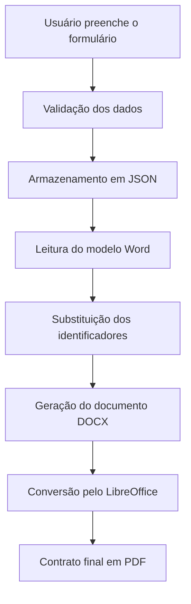
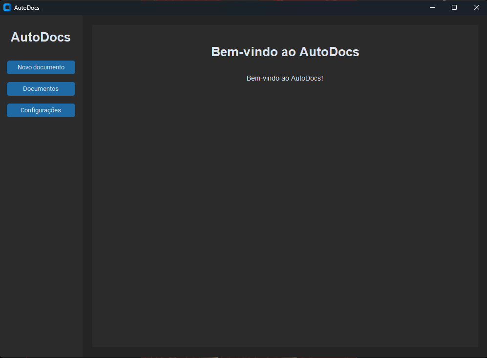
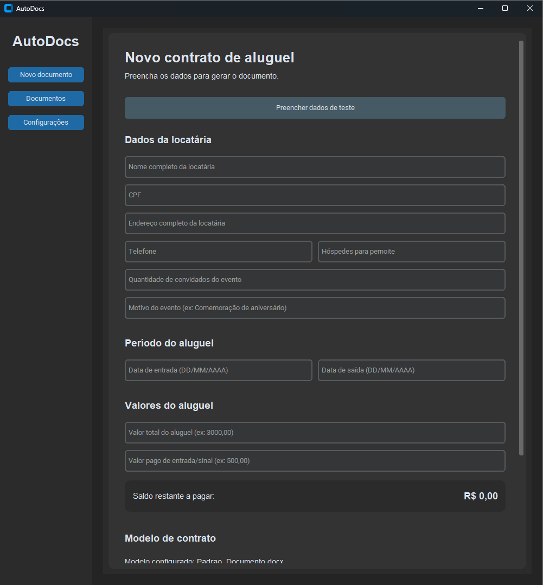
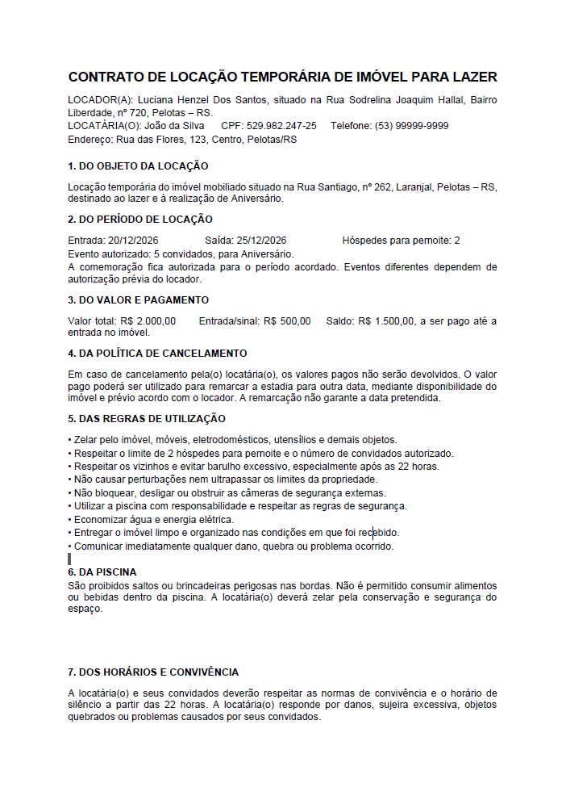

# AutoDocs

**Automação de preenchimento e geração de contratos de aluguel em PDF.**

## 1. Sobre o Projeto

O **AutoDocs** é uma aplicação desktop desenvolvida em Python com o objetivo de automatizar o preenchimento e a geração de contratos de aluguel.

O projeto surgiu da necessidade de reduzir o trabalho manual durante a elaboração desses documentos, evitando a repetição de informações, diminuindo a possibilidade de erros de preenchimento e tornando o processo mais rápido e organizado.

Por meio de uma interface gráfica, o usuário informa os dados necessários para o contrato, e o sistema realiza automaticamente a validação das informações, o preenchimento de um modelo Word e a conversão do documento para PDF.

**Principais benefícios:**
- Redução do tempo necessário para elaborar contratos;
- Diminuição de erros durante o preenchimento;
- Padronização dos documentos gerados;
- Validação automática de informações, como CPF, datas e valores;
- Geração de contratos em PDF prontos para utilização.

## 2. Arquitetura e Fluxo de Funcionamento

O funcionamento do AutoDocs é dividido em etapas, desde a entrada das informações até a geração do documento final.

### Fluxo da automação



### Etapas do processo

1. **Entrada de dados:** o usuário preenche os campos disponíveis na interface do AutoDocs.
2. **Validação:** o sistema verifica informações obrigatórias, CPF, telefone, datas e valores.
3. **Armazenamento:** os dados são organizados e salvos em um arquivo JSON.
4. **Preenchimento:** o sistema abre o modelo de contrato Word e substitui os identificadores pelos dados informados.
5. **Geração do documento:** um arquivo DOCX temporário é criado com as informações preenchidas.
6. **Conversão:** o LibreOffice é utilizado em modo automático para converter o documento Word em PDF.
7. **Saída:** o PDF final é salvo na pasta `Documentos_Gerados`.

## 3. Tecnologias e Ferramentas Utilizadas

| Tecnologia | Utilização |
|---|---|
| Python | Linguagem principal do projeto |
| CustomTkinter | Desenvolvimento da interface gráfica |
| python-docx | Leitura e edição de documentos Word |
| JSON | Armazenamento e organização dos dados |
| LibreOffice | Conversão automática de DOCX para PDF |
| os | Manipulação de arquivos e diretórios |
| subprocess | Execução do LibreOffice por linha de comando |
| re | Tratamento de textos e nomes de arquivos |

O projeto utiliza a biblioteca `python-docx` para manipular os contratos e o LibreOffice para realizar a conversão dos documentos. A comunicação entre a aplicação e o LibreOffice acontece por meio da execução de um processo externo utilizando `subprocess`.

## 4. Pré-requisitos e Como Executar

### Pré-requisitos

Antes de executar o projeto, é necessário possuir:

- Python 3.10 ou superior;
- LibreOffice instalado;
- Git para clonar o repositório.

### Instalação

**1. Clone o repositório:**

```bash
git clone https://github.com/Kauasan123/Projeto-Automa-o-Documento.git
```

**2. Acesse a pasta do projeto:**

```bash
cd Projeto-Automa-o-Documento
```

**3. Crie um ambiente virtual:**

```bash
python -m venv .venv
```

**4. Ative o ambiente virtual:**

No Windows:

```bash
.venv\Scripts\activate
```

**5. Instale as dependências:**

```bash
pip install -r requirements.txt
```

**6. Execute a aplicação:**

```bash
python main.py
```

### Configuração inicial

Ao iniciar o AutoDocs, acesse a seção **Configurações** e selecione o modelo Word que será utilizado para gerar os contratos.

O modelo deve conter os identificadores esperados pelo sistema, como `{{LOCATARIO}}`, `{{CPF}}`, `{{CHECKIN}}` e `{{VALOR_TOTAL}}`.

Após selecionar o modelo, basta acessar **Novo documento**, preencher as informações e solicitar a geração do contrato.

**Observação:** o caminho do executável do LibreOffice está configurado no código para uma instalação padrão no Windows. Caso esteja instalado em outro diretório, será necessário ajustar o caminho na função `converter_word_para_pdf()`.

O projeto não utiliza credenciais ou variáveis de ambiente externas, portanto, não é necessário configurar um arquivo `.env`.

## 5. Demonstração e Resultados

O AutoDocs permite gerar contratos preenchidos automaticamente a partir de um modelo previamente configurado.

Principais telas:

### Interface principal


### Preenchimento dos dados


### Contrato gerado


O resultado final é um contrato em PDF contendo os dados informados pelo usuário, mantendo a estrutura e o texto do modelo original.

## 6. Melhorias Futuras (Roadmap)

Algumas melhorias que podem ser implementadas futuramente:

- **Histórico de documentos:** desenvolver uma área para visualizar, localizar e organizar os contratos já gerados.
- **Portabilidade:** melhorar a identificação automática da instalação do LibreOffice e permitir a execução em diferentes sistemas operacionais.
- **Personalização dos modelos:** permitir o gerenciamento de diferentes modelos de contrato dentro da aplicação.

---

**Desenvolvido como projeto acadêmico para a disciplina de Automação e Programabilidade em Redes.**